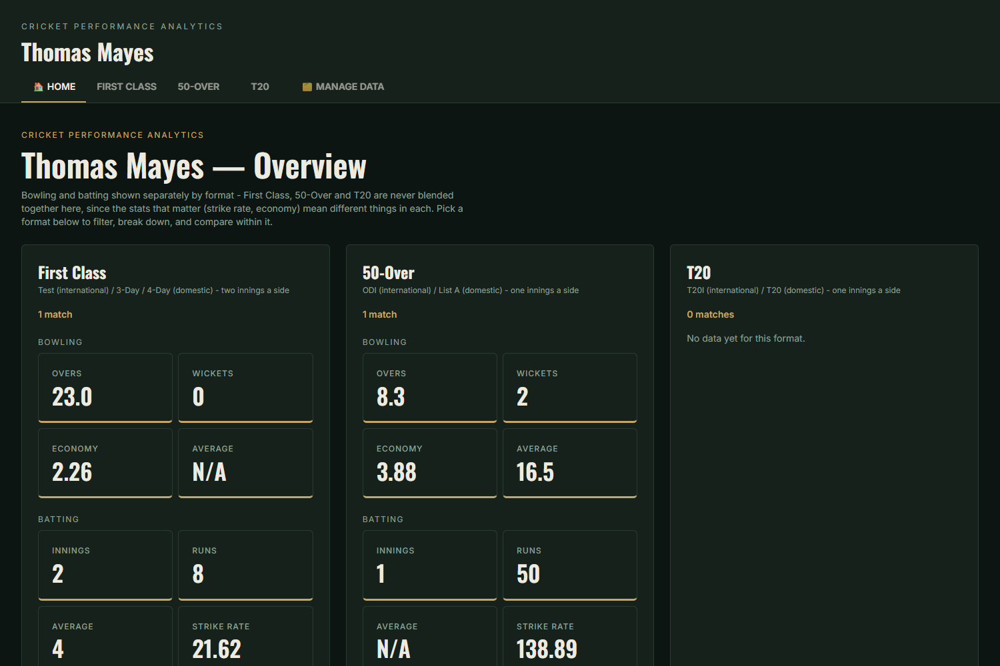
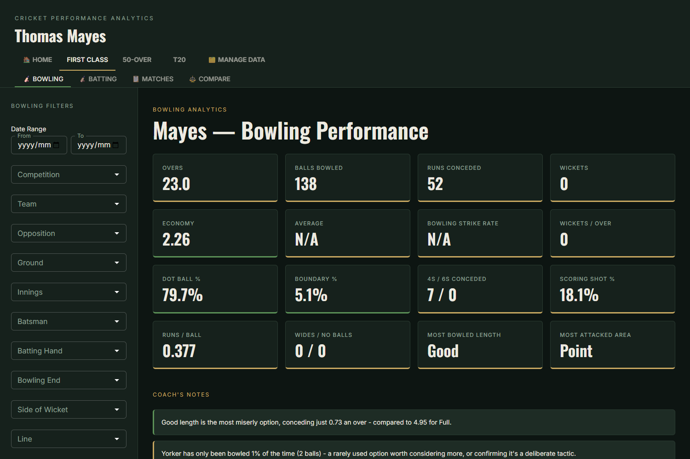
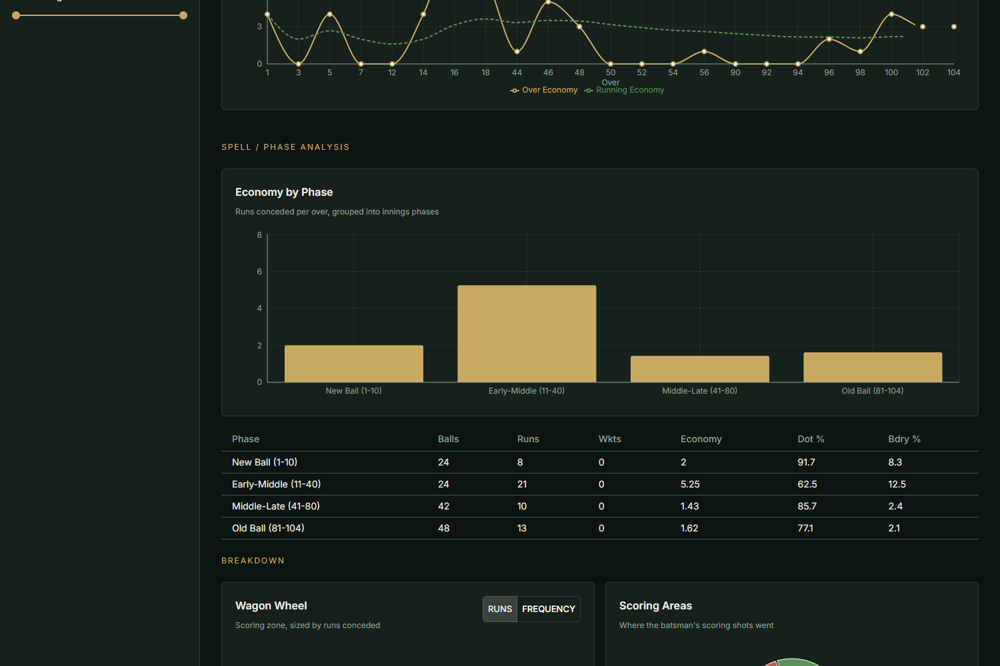
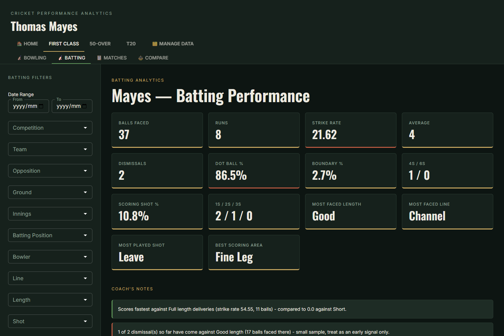
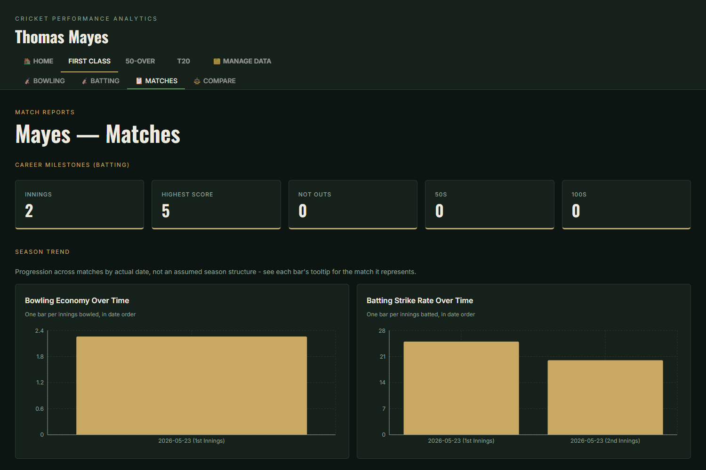
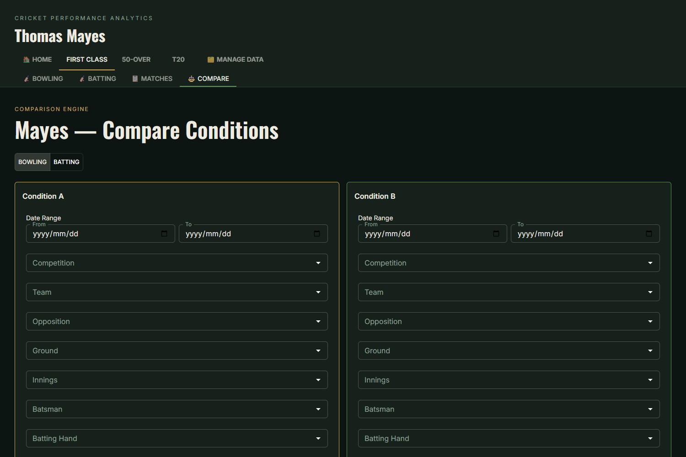
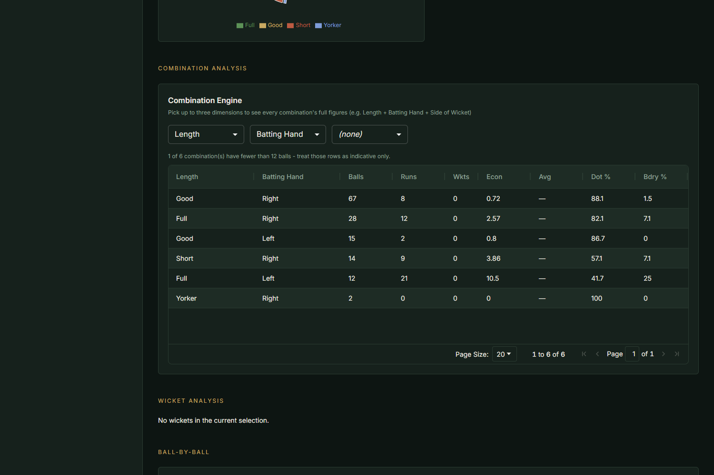
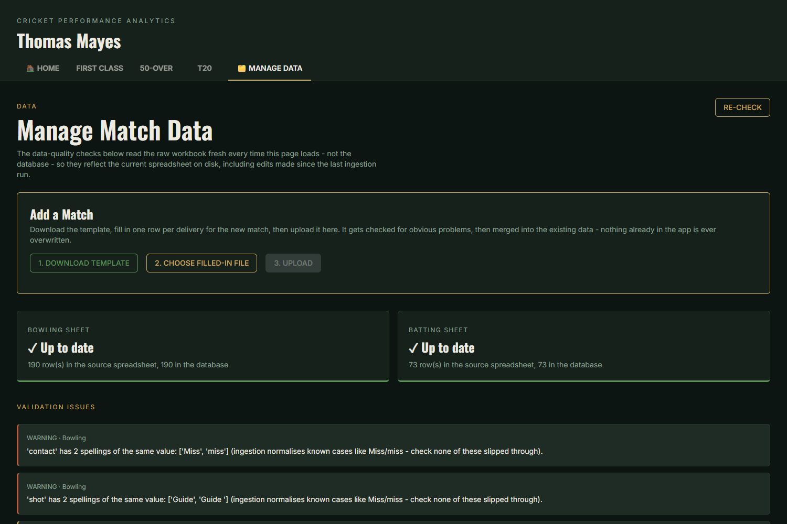

# Cricket Performance Analytics

A ball-by-ball cricket analytics platform built from scratch around one
player's real match history — Thomas Mayes, a club and provincial-level
cricketer. It turns a hand-scored spreadsheet of every delivery he's bowled
and faced into a full bowling and batting analytics dashboard: filterable by
almost any dimension a coach would actually ask about, correct about cricket's
scoring rules (no-ball runs, byes, maidens, format differences), and honest
about when a sample is too small to draw a conclusion from.

I built this independently, purely out of interest in the intersection of
cricket and data. I'm not a professional cricket analyst or a coach — I'm a
data scientist who enjoys the sport, and wanted to see how far I could take a
genuinely messy, real-world dataset (hand-scored, inconsistent spellings,
quirky spreadsheet conventions) into something a coach could actually use.
It's a work sample, not a finished product: the dataset is one player's
career so far, and a handful of design decisions below (documented, not
hidden) reflect that scope.

## Why this exists

Thomas's matches were being scored ball-by-ball into a spreadsheet — line,
length, shot, contact, runs, wickets — but that data was sitting there
unused beyond the raw scoresheet. The question this project answers: *what
can you actually learn from ball-by-ball data that a runs/wickets scorecard
can't tell you?* Things like:

- Which lengths and lines does he concede the most runs against, or take the
  most wickets with?
- Does his economy change over the course of a spell, and does that pattern
  hold up across different formats?
- What are his real strengths and weaknesses as a batter — not just "average
  32," but *where* the runs and the dismissals actually come from?
- How does he perform by ground, by opposition, by batting position, by
  format?

## What it does

### Bowling analytics
- Career and filtered figures: overs, runs, wickets, economy, average, strike
  rate, dot-ball %, maidens.
- Breakdown by any single dimension or **combination of up to three**
  (length, line, side of wicket, bowling end, batting hand of the batter,
  ground, opposition, over range, and more) — e.g. "economy by length ×
  batting hand."
- Phase-of-spell analysis (new ball vs. middle vs. death/old ball,
  format-appropriate — see [Methodology](docs/METHODOLOGY.md#phase-of-innings-analysis)),
  with a cautious note when there's a real, sample-backed shift across a
  spell.
- Wicket-taking analysis: dismissal types, and the line/length/shot that
  produced them.
- Ball-by-ball delivery log, filterable and sortable.

### Batting analytics
- Career and filtered figures: runs, balls faced, strike rate, innings-level
  stats (highest score, not-outs, 50s/100s) computed correctly at the innings
  level rather than approximated from filtered balls.
- Strengths & weaknesses panel: where Thomas scores freely and where he gets
  dismissed most, surfaced automatically from the underlying breakdowns.
- Breakdown by position, ground, opposition, phase of innings, shot played,
  and more — same combination engine as bowling.
- Dismissal analysis: how he gets out, by dismissal type, shot, and bowling
  characteristics.

### Cross-cutting
- **Format tiers kept strictly separate** — First Class, 50-Over, and T20 are
  never blended into one average, because they measure different things (see
  [Methodology](docs/METHODOLOGY.md#format-tiers-and-why-theyre-never-blended)).
- **Season / date-range trends** across a tier.
- **Match list and a head-to-head comparison view** (e.g. one ground vs.
  another, one season vs. another).
- **In-app data quality tooling** — re-validates the source spreadsheet on
  every load (not just at ingestion) and flags issues like inconsistent
  capitalisation of the same value, so data problems are visible without
  opening a terminal.
- **Add a match without touching code or SQL**: download a pre-built Excel
  template with data-validation dropdowns, fill in one row per delivery,
  upload it, and it's validated and merged into the dataset automatically.
- Every rate statistic is annotated when it's built from a small sample,
  rather than presented with false confidence (see
  [Methodology](docs/METHODOLOGY.md#sample-size-discipline)).

See **[docs/METHODOLOGY.md](docs/METHODOLOGY.md)** for exactly how every
number is computed, including the parts of cricket scoring that are easy to
get subtly wrong (no-ball runs, bye/leg-bye exclusions, maiden overs, balls
faced vs. balls bowled).

## Screenshots

**Home — format tiers at a glance**


**Bowling — career figures and filters**


**Bowling — phase analysis and wicket breakdown**


**Batting — career figures and strengths/weaknesses**


**Match list and season trend**


**Head-to-head comparison**


**Combination engine — any dimension, combined**


**Manage Data — validation and the template upload workflow**


## Data

The dataset is Thomas Mayes's own real, hand-scored ball-by-ball match
history — genuine matches, played and scored as they happened, not simulated
or synthetic data. It currently covers 190 bowling deliveries and 73 batting
deliveries across First Class, 50-Over, and T20 cricket. Thomas has agreed to
this data, including real opposition players' names where they appear as
context on a delivery (e.g. "the batter Thomas bowled to"), being published
as part of this portfolio project.

Source data lives in a single Excel workbook
(`backend/data/raw/Mayes_Bowling_Batting.xlsx`) with two sheets — one row per
delivery for bowling, one row per delivery for batting — plus a categories
sheet used for the upload template's dropdown validation. The database is
never hand-edited: it's fully rebuilt from this workbook by the ingestion
pipeline every time, which is what makes the "download template → fill in →
upload → merges automatically" workflow safe (see
[Methodology](docs/METHODOLOGY.md) for the validation rules that guard it).

## Tech stack

**Backend**
- Python 3, FastAPI, SQLite (via the standard library `sqlite3`, no separate
  database server)
- pandas + openpyxl for reading and cleaning the source spreadsheet
- No ORM — SQL and pandas directly, deliberately, given the schema's size

**Frontend**
- React 19 + TypeScript, built with Vite
- MUI for layout and components, Recharts for charts, AG Grid for the
  ball-by-ball delivery table

**Nothing else** — no external APIs, no authentication, no environment
variables or secrets. The app reads a local spreadsheet and serves a local
database; there's genuinely nothing to configure beyond installing
dependencies, which is why there's no `.env.example` in this repo.

## Project structure

```
cricket-analytics/
├── backend/
│   ├── app/
│   │   ├── main.py                # FastAPI app, all /api/* endpoints
│   │   ├── db/                    # schema.sql, connection/init helpers
│   │   ├── ingestion/             # spreadsheet -> SQLite pipeline, upload/merge, validation
│   │   ├── services/              # stats engines, filters, format classification, insights
│   │   └── analysis_demo.py       # quick sanity-check script against real numbers
│   ├── data/raw/                  # the source workbook
│   └── requirements.txt
├── frontend/
│   └── src/
│       ├── dashboards/            # Home, Bowling, Batting, Matches, Compare, Manage Data
│       ├── components/            # filter sidebar, tables, charts, panels
│       └── api/, types/           # typed API client
└── docs/
    ├── METHODOLOGY.md
    └── images/
```

## Running it locally

Requires Python 3.11+ and Node 18+.

**Backend**
```bash
cd backend
python -m venv venv
venv\Scripts\activate      # macOS/Linux: source venv/bin/activate
pip install -r requirements.txt
python -m app.ingestion.load_spreadsheet   # builds the database from the spreadsheet
uvicorn app.main:app --reload --port 8000
```

**Frontend** (separate terminal)
```bash
cd frontend
npm install
npm run dev
```

Open the URL Vite prints (typically `http://localhost:5173`). The dev server
proxies `/api` requests to the backend — if you change the backend port,
update the `proxy.target` in `frontend/vite.config.ts` to match.

If the spreadsheet changes (a new match, a correction), re-run
`python -m app.ingestion.load_spreadsheet` to rebuild the database, or use the
in-app "Manage Data" upload workflow for a new match.

## Example analyses this enables

- "What's his economy bowling full-length deliveries to right-handers,
  broken down by ground?" — three dimensions, one combination-engine query.
- "Does his death-overs economy in T20 hold up compared to his powerplay
  economy?" — phase breakdown, T20 tier only.
- "Where does he actually lose his wicket most often as a batter — and to
  what kind of delivery?" — dismissal analysis, cross-referenced with the
  bowling-side length/line fields on those deliveries.
- "Has his First Class strike rate trended up or down across seasons?" —
  season trend view, First Class tier only (never blended with the limited-overs numbers).

## Possible extensions

Documented honestly as *ideas*, not built features:

- Supporting more than one tracked player (the schema is deliberately
  single-player for now — see [Methodology](docs/METHODOLOGY.md#what-this-app-does-not-do)).
- Bowler-vs-batter head-to-head views once opposition players are tracked as
  entities rather than free text.
- Partnership-level batting analysis.
- Match result / win-loss correlation, once result data is captured.

## License

MIT — see [LICENSE](LICENSE).
